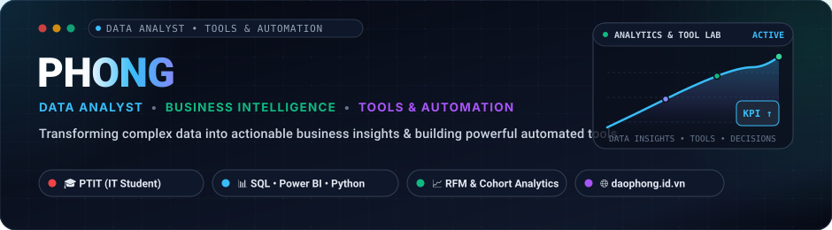
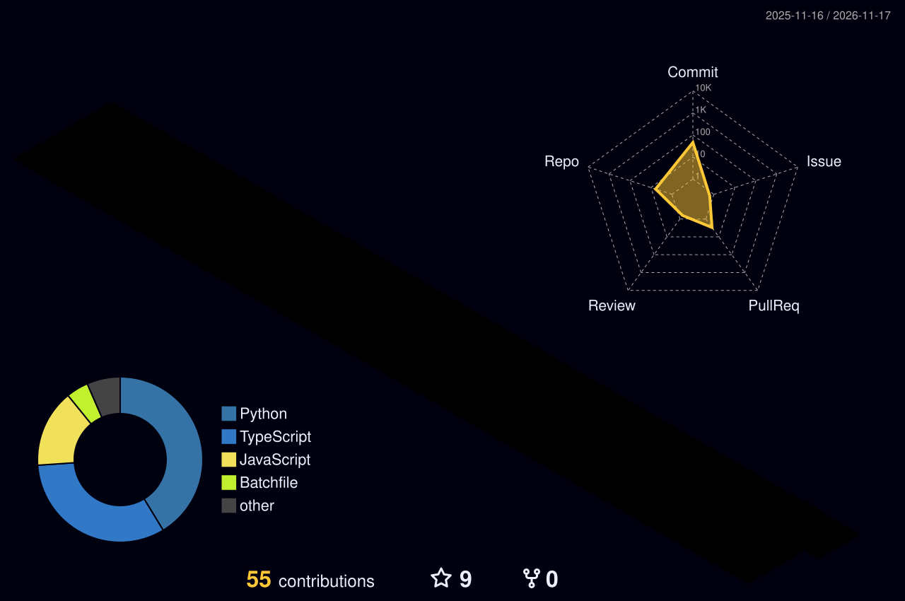

<div align="center">

  

  <br/><br/>

  <a href="https://github.com/ngphong01">
    
  </a>

  <br/>

  <p align="center">
    <a href="https://www.daophong.id.vn/"></a>
    <a href="https://github.com/ngphong01"></a>
    
    
  </p>

</div>

---

### 👤 About Me

Xin chào! Mình là **Đào Văn Phong**, sinh viên ngành Công nghệ Thông tin tại **Học viện Công nghệ Bưu chính Viễn thông (PTIT)**, Hà Nội.

Mình định hướng phát triển sự nghiệp trở thành một **Data Analyst / Business Intelligence Analyst** với tư duy giải quyết bài toán kinh doanh dựa trên dữ liệu (*Actionable Insights*), kết hợp nền tảng kỹ thuật vững chắc để tự động hóa công cụ:

- 📊 **Data Analytics & Business Intelligence:** Chuyên sâu về phân tích dữ liệu bán lẻ, thương mại điện tử và dịch vụ. Sử dụng thành thạo **SQL** (CTEs, Window Functions), **Power BI** (Data Modeling Star Schema, DAX nâng cao), **Python** (Pandas, NumPy, Matplotlib/Seaborn) và Excel nâng cao để phân tích hành vi khách hàng (RFM), tỷ lệ giữ chân (Cohort Retention) và tối ưu hóa doanh thu.
- ⚙️ **Tools & System Automation:** Đam mê xây dựng các công cụ tối ưu hóa và tự động hóa: từ tiện ích quản trị ổ đĩa Windows chuyên sâu (`winvitals`), công cụ tự động hóa cấu hình (`Device_Changer`), đến nền tảng du lịch trực tuyến (`TravelHub`).
- 💡 **Phương châm:** *“Biến dữ liệu thô thành giá trị kinh doanh thực tế và không ngừng xây dựng các công cụ giải quyết bài toán thật.”*

---

### 🛠️ Core Stack & Capabilities

<table>
  <tr>
    <td width="26%" align="center"><b>Phân tích Dữ liệu (DA & BI)</b></td>
    <td>
      
      
      
      
      
      
      
      
      
    </td>
  </tr>
  <tr>
    <td align="center"><b>Kỹ năng Nghiệp vụ (Business)</b></td>
    <td>
      
      
      
      
      
    </td>
  </tr>
  <tr>
    <td align="center"><b>Công cụ & Kỹ thuật (Tools)</b></td>
    <td>
      
      
      
      
      
    </td>
  </tr>
</table>

---

### 🚀 Featured Projects on GitHub

| Dự Án | Lĩnh Vực / Công Nghệ | Mô Tả Thực Chiến |
|:---|:---|:---|
| 🛒 [**olist-ecommerce-analytics-rfm**](https://github.com/ngphong01/olist-ecommerce-analytics-rfm) | `SQL` • `Power BI` • `Python` • `RFM & Retention` | **Dự án Đinh Phân tích E-Commerce trên 100.000+ giao dịch Olist:** Làm sạch dữ liệu, xây dựng mô hình phân khúc RFM, tính toán ma trận Cohort Retention qua từng tháng và thiết kế Executive Dashboard trên Power BI. |
| 🏨 [**TravelHub**](https://github.com/ngphong01/TravelHub) | `TypeScript` • `React` • `Node.js` • `REST API` | **Nền tảng thương mại điện tử du lịch & đặt phòng trực tuyến:** Thiết kế luồng dữ liệu khách sạn, xử lý tìm kiếm phòng, tích hợp giao diện người dùng hiện đại và hệ thống API RESTful. |
| 🛡️ [**winvitals**](https://github.com/ngphong01/winvitals) | `Python` • `C++` • `Windows Optimization` | **Windows Health Manager & Developer Disk Manager:** Công cụ quản trị và tối ưu hóa ổ đĩa chuyên sâu, giám sát trạng thái phần cứng và dọn dẹp hệ thống cho lập trình viên. |
| ⚙️ [**Device_Changer**](https://github.com/ngphong01/Device_Changer) | `Python` • `System Automation` | **Bộ công cụ phân tích cấu hình & tự động hóa:** Quản trị tham số thiết bị, tự động hóa các kịch bản kiểm thử và tương tác hệ thống. |
| 🏍️ [**SmartHelmet**](https://github.com/ngphong01/SmartHelmet) | `Python` • `IoT` • `Sensor Analytics` | **Hệ thống mũ bảo hiểm thông minh:** Phân tích dữ liệu cảm biến thời gian thực, tự động phát hiện va chạm khẩn cấp và truyền tọa độ định vị cảnh báo. |
| 🔔 [**FIX_NOTIFICATION_XIAOMI**](https://github.com/ngphong01/FIX_NOTIFICATION_XIAOMI) | `Batch Script` • `OS Tweaks` | **Tiện ích tối ưu hóa thông báo Android:** Tinh chỉnh các tham số quản lý tiến trình ngầm (background processes) giúp hệ thống nhận thông báo tức thì, không bị trễ. |

---

### 📊 Highlight: E-Commerce RFM & Retention Analysis
Dự án phân tích dữ liệu nổi bật nhất trên hồ sơ:

```text
┌────────────────────────────────────────────────────────────────────────┐
│             OLIST E-COMMERCE CUSTOMER ANALYTICS & RETENTION            │
├────────────────────────────────────────────────────────────────────────┤
│  📊 Dữ liệu: 100.000+ đơn hàng | 93.358 khách hàng | 13.2 triệu BRL GMV │
│  🔍 Kỹ thuật: SQL CTEs & Window Functions, Python Pandas, Star Schema  │
│  📈 Mô hình: Phân khúc RFM (5 phân vị), Ma trận Cohort Retention       │
│  🎯 Dashboard: Power BI 3 trang (Executive KPI, Cohort, RFM Action)    │
└────────────────────────────────────────────────────────────────────────┘
```

👉 **Chi tiết mã nguồn & Dashboard:** [https://github.com/ngphong01/olist-ecommerce-analytics-rfm](https://github.com/ngphong01/olist-ecommerce-analytics-rfm)

---

### 📊 GitHub Activity & Statistics

<div align="center">

  <table border="0">
    <tr>
      <td width="50%" align="center">
        <a href="https://github.com/ngphong01">
          
        </a>
      </td>
      <td width="50%" align="center">
        <a href="https://github.com/ngphong01">
          
        </a>
      </td>
    </tr>
  </table>

  <br/>

  <a href="https://github.com/ngphong01">
    
  </a>

</div>

---

### 🧊 3D GitHub Contributions

<div align="center">

  <picture>
    <source media="(prefers-color-scheme: dark)" srcset="https://raw.githubusercontent.com/ngphong01/ngphong01/main/profile-3d-contrib/profile-night-rainbow.svg" />
    <source media="(prefers-color-scheme: light)" srcset="https://raw.githubusercontent.com/ngphong01/ngphong01/main/profile-3d-contrib/profile-night-rainbow.svg" />
    
  </picture>

</div>

---

### 📬 Connect With Me

<p align="center">
  <a href="https://www.daophong.id.vn/">
    
  </a>
  <a href="https://github.com/ngphong01">
    
  </a>
  <a href="mailto:phong.ptit.dev@gmail.com">
    
  </a>
</p>

<p align="center">
  <sub>✨ <i>"Biến dữ liệu thô thành giá trị kinh doanh thực tế và không ngừng xây dựng các công cụ có ích."</i> ✨</sub>
</p>
