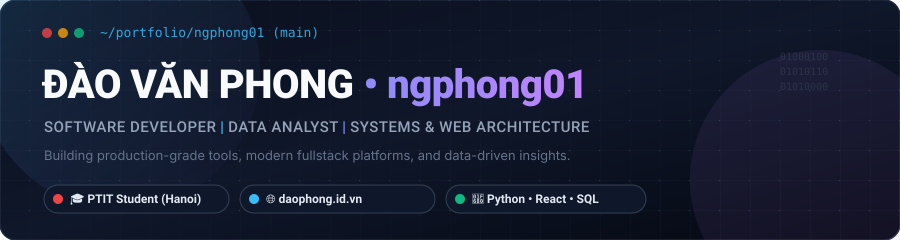
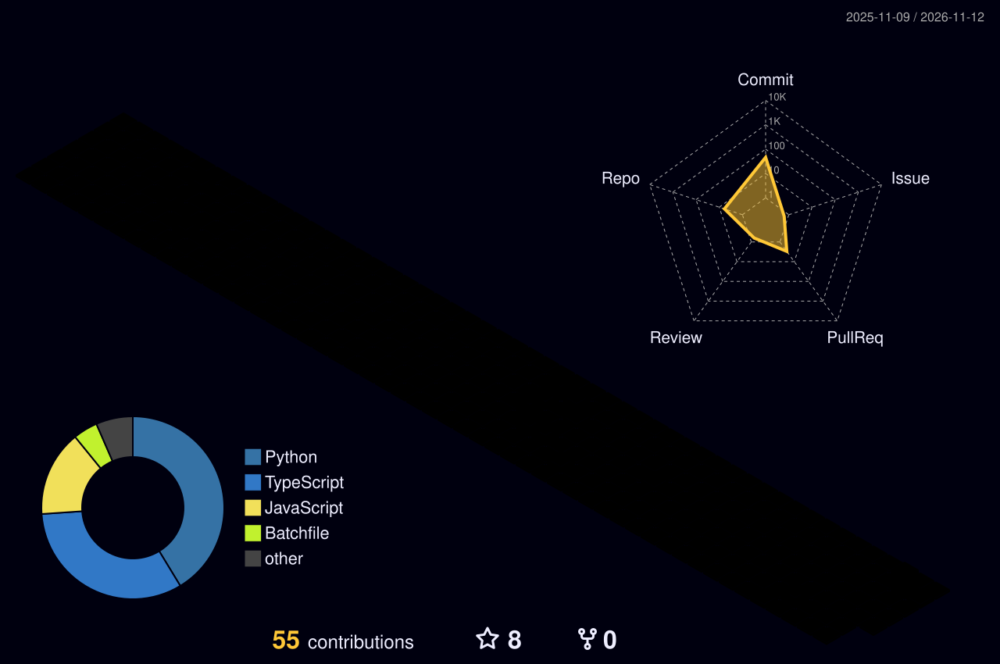

```html
<div align="center">

  <!-- Header Banner -->
  

  <br/><br/>

  <!-- Typing Headline -->
  <a href="https://github.com/ngphong01">
    
  </a>

  <br/><br/>

  <!-- Main Links -->
  <a href="https://www.daophong.id.vn/">
    
  </a>

  <a href="https://www.youtube.com/@ngphong01">
    
  </a>

</div>

---

## 👋 About Me

Xin chào, mình là **Đào Văn Phong**, sinh viên Công nghệ Thông tin tại **Học viện Công nghệ Bưu chính Viễn thông (PTIT)**.

Hiện tại mình tập trung vào hai hướng có liên quan trực tiếp với nhau:

- 📊 **Data Analyst:** Học và thực hành phân tích dữ liệu bằng Excel, SQL, Python và Power BI.
- 🎬 **YouTube Creator:** Xây dựng nội dung về công nghệ, dữ liệu và hành trình học tập.
- 💡 Mục tiêu của mình là kết hợp **Data × Creator** — sử dụng dữ liệu để hiểu hiệu suất nội dung, hành vi người xem và đưa ra quyết định tốt hơn.

> **Data tells the story. Creativity makes it worth watching.**

---

## 🛠️ Data Analyst Stack

<div align="center">

### Core Tools


<br/>

### Database & Analysis


</div>

### 🌱 Currently Learning

`Advanced SQL` • `DAX` • `Data Storytelling` • `Dashboard Design`

---

## 📈 Featured Data Projects

> Các dự án dưới đây là những bài toán mình đang xây dựng trong quá trình học và phát triển portfolio.

### 🎬 YouTube Analytics Dashboard
**Status:** 🚧 In Progress

`Python` • `Pandas` • `Power BI` • `YouTube Data`

Phân tích dữ liệu hoạt động của kênh YouTube nhằm tìm hiểu:

- Hiệu suất của từng video
- Views và mức độ tương tác
- Tăng trưởng người xem
- Chủ đề nội dung có hiệu quả tốt
- Xu hướng phát triển của kênh

---

### 📊 Sales Performance Dashboard
**Status:** 🚧 In Progress

`Power BI` • `Excel` • `DAX`

Dashboard trực quan hóa dữ liệu bán hàng, tập trung vào:

- Doanh thu
- Lợi nhuận
- Sản phẩm
- Khu vực
- Xu hướng theo thời gian

---

### 🗄️ SQL Business Analysis
**Status:** 🚧 In Progress

`SQL` • `PostgreSQL`

Thực hành SQL thông qua các bài toán phân tích dữ liệu doanh nghiệp:

- Customer Analysis
- Revenue Analysis
- Product Performance
- Ranking
- CTE
- Window Functions

---

### 🐍 Python Exploratory Data Analysis
**Status:** 🚧 In Progress

`Python` • `Pandas` • `Matplotlib`

Quy trình phân tích dữ liệu từ đầu:

`Raw Data → Cleaning → Exploration → Visualization → Insights`

---

## 🎬 YouTube

<div align="center">

### Data • Technology • Learning Journey

Mình xây dựng nội dung xoay quanh hành trình học tập và phát triển trong lĩnh vực công nghệ và dữ liệu.

</div>

### Nội dung chính

📊 **Data Learning**  
Chia sẻ quá trình học Excel, SQL, Python, Power BI và xây dựng portfolio.

🎥 **Technology**  
Các nội dung, công cụ và trải nghiệm liên quan đến công nghệ.

🚀 **Learning Journey**  
Ghi lại quá trình từ sinh viên đến khi có thể làm việc thực tế trong lĩnh vực Data Analytics.

<div align="center">

<a href="https://www.youtube.com/@ngphong01">
  
</a>

</div>

---

## 🧊 3D GitHub Contributions

<div align="center">

<picture>
  <source
    media="(prefers-color-scheme: dark)"
    srcset="https://raw.githubusercontent.com/ngphong01/ngphong01/main/profile-3d-contrib/profile-night-rainbow.svg"
  />
  <source
    media="(prefers-color-scheme: light)"
    srcset="https://raw.githubusercontent.com/ngphong01/ngphong01/main/profile-3d-contrib/profile-night-rainbow.svg"
  />
  
</picture>

</div>

---

## 📬 Connect With Me

<div align="center">

<a href="https://www.daophong.id.vn/">
  
</a>

<a href="https://www.youtube.com/@ngphong01">
  
</a>

<a href="https://github.com/ngphong01">
  
</a>

<a href="mailto:phong.ptit.dev@gmail.com">
  
</a>

<br/><br/>

<sub>
  ✨ <i>"Dữ liệu là sự thật, sáng tạo là cách kể chuyện."</i> ✨
</sub>

</div>
```
